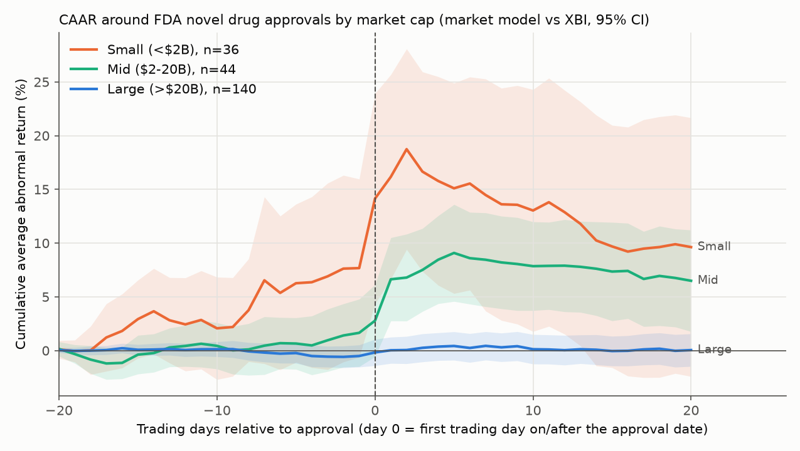
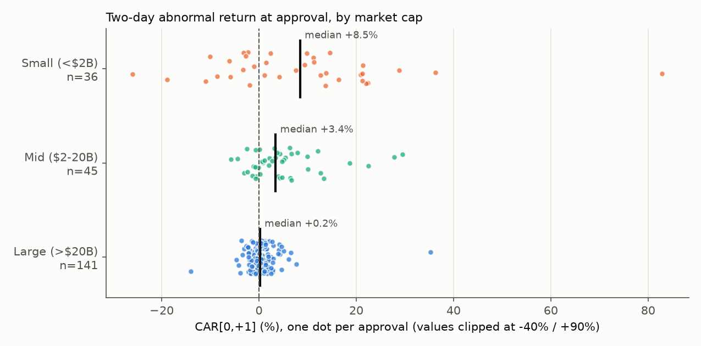

# How do biotech stocks react to FDA novel drug approvals?

[](https://github.com/lukahere007/biotech-fda-event-study/actions/workflows/ci.yml)

[](LICENSE)

This is a classic event study (MacKinlay 1997) of **234 FDA novel drug approvals from 2015 to 2024** for 76 companies with US-listed stock. Abnormal returns come from a market model estimated against the XBI biotech ETF.

## The answer

**It depends almost entirely on company size.** For big pharma, a new approval doesn't measurably move the stock. For small biotechs it's a large event, and the stock usually starts rising before the approval.

| CAR over [0,+1] (2 days) | n | Mean CAR | 95% CI | Median | p (cross-sectional t) | p (BMP) | p (Wilcoxon) |
|---|---|---|---|---|---|---|---|
| **All events** | 234 | **+2.8%** | +1.6% to +4.0% | +0.6% | <0.001 | <0.001 | <0.001 |
| Small cap (<$2B) | 36 | **+8.5%** | +2.2% to +14.8% | +8.5% | 0.010 | 0.012 | 0.007 |
| Mid cap ($2–20B) | 45 | **+4.9%** | +2.6% to +7.2% | +3.4% | <0.001 | <0.001 | <0.001 |
| Large cap (>$20B) | 141 | +0.5% | −0.1% to +1.2% | +0.2% | 0.100 | 0.057 | 0.069 |
| First approval for the company | 50 | +7.1% | +2.4% to +11.7% | +2.9% | 0.004 | 0.003 | 0.002 |
| Company had earlier approvals | 184 | +1.6% | +0.8% to +2.5% | +0.4% | <0.001 | <0.001 | <0.001 |

Market cap is measured 30 trading days before the approval. 12 events have no market cap available. All windows and groups are in [`results/car_tests.csv`](results/car_tests.csv).



- **Big pharma: no detectable effect.** A single approval is a small share of a $100B+ company's value, and the approval itself was mostly expected. The large-cap mean of +0.5% is not significantly different from zero.
- **Small biotechs: a large but highly variable reaction.** The mean and the median are both about +8.5%. Even so, 36% of small-cap approvals had a *negative* two-day abnormal return. The FDA said yes, and the price still fell.
- **Prices move before the announcement.** Small caps gained **+7.6% in the [−20,−2] window** (p ≈ 0.08). PDUFA dates are public, so investors can position early. Small caps with a bigger pre-event run-up tended to react worse at approval (Spearman ρ = −0.31, p = 0.07). For example, Xdemvy rose +27% in the run-up and then fell −26% at approval. Ibsrela more than doubled beforehand and fell −6%. Each of these results is suggestive on its own, not conclusive.
- **Some of the move reverses afterwards.** Small caps lost −6.5% over [+2,+20] (BMP p = 0.04, cross-sectional p = 0.09). "First approval" companies, which are mostly the same small caps, lost −7.4% (p = 0.002).
- **The approval-day reaction is real, not leakage.** There is no significant abnormal return on any single day from −5 to −1. The average abnormal return is +1.4% on day 0 and +1.4% on day +1, and trading volume peaks on day +1 (1.5× normal). This matches the FDA posting many approvals after the market closes.
- **The result doesn't depend on the benchmark.** Re-running with SPY instead of XBI gives +8.8% for small caps, +5.2% for mid caps and +0.4% for large caps ([`results/robustness_spy.csv`](results/robustness_spy.csv)).



**What this is not:** a trading strategy. Positive average returns on approval day would require knowing the outcome in advance. The study only sees approvals (see *Limitations*), and the small-cap estimates rest on 36 events with very wide confidence intervals.

## Method

| Step | Choice |
|---|---|
| **Events** | CDER novel approvals: Drugs@FDA original NDAs classed **Type 1 (new molecular entity)**, plus original BLAs for a **new biologic** (active ingredient never approved before, so biosimilars and reformulations are excluded). This gives 462 approvals for 2015–2024, compared with 465 in CDER's published yearly counts. Year-by-year counts match to within 1 ([`data/interim/novel_counts_by_year.csv`](data/interim/novel_counts_by_year.csv)). |
| **Ticker** | Each approval is assigned to the company that **held it on the approval date**, not to today's owner. For example, Tibsovo goes to Agios rather than Servier, and Ongentys goes to Neurocrine rather than Amneal. Automatic name matching against current Nasdaq/NYSE listings is followed by a hand-curated override file, [`data/sponsor_ticker_map.csv`](data/sponsor_ticker_map.csv), with 243 rows, each with a status and a note. The ownership histories in it were compiled from general knowledge of company histories and have not been independently checked against filings; corrections are welcome. Sponsors that are foreign-only or OTC-only, private, nonprofit or unverified are excluded. |
| **Day 0** | The first trading day on or after the approval date. Weekend and holiday approvals roll forward. The FDA often announces after the 4 pm close, so the reaction can land on day 0 or day +1. The headline window **[0,+1]** covers both. |
| **Normal returns** | Market model `R_i = α + β·R_XBI` fitted by OLS on the estimation window **[−250, −30]**, which needs at least 120 valid days. SPY is used as a robustness check. |
| **Tests** | Cross-sectional t-test (robust to event-induced variance). **BMP** standardised test (Boehmer, Musumeci & Poulsen 1991), where the CAR variance includes market-model estimation error. Sign test (exact binomial). Wilcoxon signed-rank test. The plotted confidence bands are cross-sectional 95% intervals. |
| **Confounding** | Two approvals for one ticker on the same day count as one event. An approval within 10 trading days after another for the same ticker is dropped. |
| **Size** | Yahoo shares-outstanding × close at day −30, measured before the run-up. Yahoo closes are split-adjusted to today, so splits after the share-count date are undone. A unit test covers this. |
| **First approval** | The company has no earlier original NDA/BLA approval in Drugs@FDA under any sponsor name mapped to the same ticker. This is a proxy and overlaps heavily with small caps: 29 of the 50 first approvals are small caps. |

### Attrition: from 462 approvals to 234 events

| Step | Events |
|---|---|
| Novel approvals 2015–2024 (Drugs@FDA) | 462 |
| − sponsor not listed on a US exchange (foreign / OTC only, e.g. Roche/Genentech, Astellas, Bayer, Daiichi) | −81 |
| − sponsor private at approval (e.g. Boehringer, Chiesi, Servier) | −47 |
| − approval-time holder not verified (conservatively excluded) | −9 |
| − nonprofit / academic sponsor | −5 |
| − acquired, old ticker unusable (e.g. Nurtec's Biohaven; `ARRY` symbol now reused by a solar company) | −3 |
| **Mapped to the approval-time holder's ticker** | **317** |
| − no Yahoo price history (company since acquired or bankrupt, e.g. Alexion, Celgene, Seagen, Immunomedics) | −80 |
| − confounded: within 10 trading days of another approval for the same ticker | −2 |
| − fewer than 120 days of pre-event prices (Harmony: IPO a year after Wakix's approval) | −1 |
| **Final sample** | **234** |

The 80 events lost because acquired companies have no price history are the main **survivorship bias**. Those companies were often acquired *because* their drugs did well, so the surviving small-cap sample probably understates the typical small-cap reaction. That is an assumption, not a measured result. Generated by code: [`results/attrition.csv`](results/attrition.csv).

## What this project demonstrates

- **Building an event study from scratch:** day-0 alignment, market-model estimation, CAR/CAAR, and both parametric (t, BMP) and non-parametric (sign, Wilcoxon) tests.
- **Tests on synthetic data where the true effect is known:** a +5% jump injected on day 0 is recovered within the confidence interval. A jump on day +1 shows up in [0,+1] and not on day 0. Null data gives no excess false positives. Weekend and holiday approvals roll to the right trading day. The event list does not depend on openFDA's row order. Splits are undone correctly in the market-cap calculation.
- **Honest data work:** each step that drops events is counted. Product ownership is traced back to the approval date rather than taken from today's sponsor field. The hand-curated mapping is a CSV with a note per row, not hidden code.
- **Reproducible fetching:** data comes from GitHub Actions because the development sandbox cannot reach FDA or market data hosts. fda.gov, accessdata.fda.gov and sec.gov also block GitHub's runners, so official equivalents were used instead (see *Data sources*).

## Reproduce

```bash
git clone https://github.com/lukahere007/biotech-fda-event-study.git
cd biotech-fda-event-study
python -m venv .venv && source .venv/bin/activate
pip install -r requirements.txt

pytest                          # 15 unit tests (synthetic data)
python scripts/run_analysis.py  # results/*.csv, results/summary.json, figures/*.png (~20 s)
```

The analysis runs on the committed data snapshot. To refresh the data, use the **Fetch data** workflow in `.github/workflows/fetch-data.yml`, or run it locally:

```bash
pip install -r requirements-fetch.txt
python scripts/fetch_sources.py   # openFDA Drugs@FDA + Nasdaq Trader listings -> data/raw/
python scripts/build_events.py    # novel approvals + ticker mapping -> data/events_mapped.csv
python scripts/fetch_market.py    # yfinance prices, splits, shares -> data/
```

`build_events.py` works offline. After editing `data/sponsor_ticker_map.csv`, re-run it and then `fetch_market.py` to pick up new tickers.

## Project structure

```
├── data/
│   ├── raw/                      # openFDA Drugs@FDA tables, exchange listings, fetch log
│   ├── sponsor_ticker_map.csv    # hand-curated sponsor/product -> ticker overrides (with notes)
│   ├── events_mapped.csv         # 462 novel approvals with mapping status
│   ├── interim/                  # sponsor review sheet, yearly counts vs CDER
│   ├── prices.parquet            # daily prices (event tickers + XBI, IBB, SPY), 2013-2025
│   └── splits.csv, shares_outstanding.csv.gz
├── src/fda_event/
│   ├── events.py                 # novel-approval definition, name normalisation, ticker mapping, confounding
│   ├── model.py                  # returns, day-0 alignment, market model, abnormal returns
│   ├── stats.py                  # CAR, BMP variance, t / BMP / sign / Wilcoxon tests, CAAR path
│   ├── pipeline.py               # attrition, market cap, prior approvals, result tables
│   └── config.py                 # windows, size buckets, dates
├── scripts/                      # fetch_sources, build_events, fetch_market, run_analysis
├── results/                      # car_tests.csv, event_cars.csv, attrition.csv, robustness_spy.csv, ...
├── figures/
└── tests/test_event_study.py
```

## Limitations

- **Only good news.** Drugs@FDA records approvals. Complete Response Letters (rejections) were historically not public (FDA only began publishing them in 2025), so this study looks only at the positive outcome of a binary event. The average approval-day return therefore cannot be read as "what the market expected". The rejection side, which is often a very bad day for small caps, is missing.
- **Survivorship.** 80 mapped events have no price history because the company was later acquired or went bankrupt (see above).
- **Current-sponsor field.** Drugs@FDA lists today's application holder. Approval-date ownership was traced by hand: 59 product-level overrides plus date-bounded sponsor rules (e.g. Alexion before and after AstraZeneca). Mistakes are possible, so each decision is in the CSV with a note, and 9 unclear cases were excluded rather than guessed.
- **Small subgroups.** With 36 small-cap events the CI spans +2% to +15%. Many windows and groups are tested, so the marginal results (pre-event run-up, post-event reversal, run-up vs reaction) are exploratory.
- **Benchmark.** XBI is an equal-weighted small/mid biotech index. It is a natural benchmark for small biotechs but a poorer one for big pharma, which is why SPY is used as a check. Events on the same calendar day are treated as independent; there are few of them.
- **Market cap** uses Yahoo share counts, which are sometimes sparse. For 24 events the nearest share count is *after* the measurement date (within 400 days). 12 events have no share data, mostly large foreign ADRs in 2015–2017. The <$2B / $20B cut-offs are a convention.
- **Event date ≠ news date** for a few approvals that leaked or were announced by the company first. The [−1,+1] and [−5,+5] windows cover this.

## Data sources and licences

- **openFDA Drugs@FDA** bulk file (`download.open.fda.gov/drug/drugsfda/`), snapshot dated 2026-10-27: applications, products and submissions, including chemical-type class codes. openFDA data is public domain ([open.fda.gov/license](https://open.fda.gov/license/)). The FDA's own fda.gov and Drugs@FDA download pages, and SEC EDGAR, return 403/404 to GitHub-hosted runners, so they could not be fetched reproducibly.
- **CDER novel approval counts** per year (45, 22, 46, 59, 48, 53, 50, 37, 55, 50) are the totals published on FDA's "Novel Drug Approvals for YYYY" pages, entered by hand rather than downloaded (fda.gov blocks GitHub's runners). They are used only as a sanity check.
- **Nasdaq Trader symbol directories** (`nasdaqlisted.txt`, `otherlisted.txt`) for current exchange listings.
- **Yahoo Finance via [yfinance](https://github.com/ranaroussi/yfinance)**: daily adjusted prices, splits and shares outstanding for event tickers, XBI, IBB and SPY. Use is subject to Yahoo's terms and is for research and education only.
- MacKinlay, A. C. (1997). Event Studies in Economics and Finance. *Journal of Economic Literature* 35(1), 13–39.
- Boehmer, E., Musumeci, J., & Poulsen, A. B. (1991). Event-study methodology under conditions of event-induced variance. *Journal of Financial Economics* 30(2), 253–272.

## License

MIT. See [LICENSE](LICENSE).
